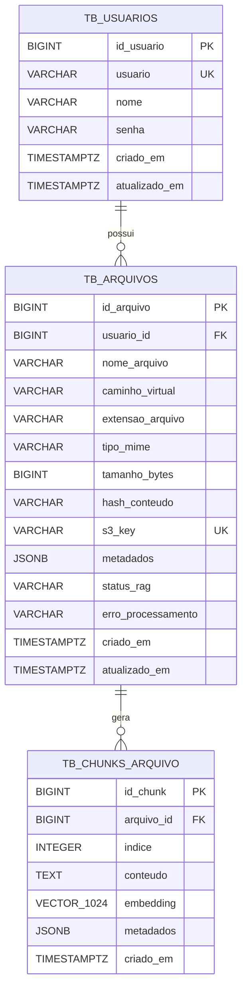

# Modelagem do banco de dados — MVP

Data da modelagem: 29/10/2026.

Status: modelo-alvo para revisão e implementação. Não representa uma migração já executada.

## 1. Objetivo

Definir o menor modelo de dados capaz de sustentar o escopo acordado para o FileMind:

- usuários proprietários de arquivos;
- arquivos Markdown armazenados no Amazon S3;
- metadados e estado do processamento no PostgreSQL;
- chunks e embeddings armazenados com pgvector;
- recuperação de contexto sempre restrita ao proprietário do arquivo.

Este documento evolui o protótipo de 14/10/2026. O arquivo `prototipo-mvp.sql` continua preservado como fotografia do backend existente naquela data.

## 2. Limites desta modelagem

Entram no modelo:

- usuários;
- arquivos;
- chunks e embeddings;
- caminho virtual;
- estados e erros do processamento RAG;
- metadados opcionais em JSONB.

Não entram neste momento:

- tabela de pastas;
- compartilhamento de arquivos;
- permissões por arquivo;
- histórico de chat;
- memória persistente de agentes;
- versionamento completo de documentos;
- auditoria detalhada.

## 3. Decisões de modelagem

### 3.1. Conteúdo e armazenamento

O conteúdo integral do arquivo fica no S3. O PostgreSQL mantém identificação, propriedade, organização, metadados e estado do processamento.

O conteúdo textual dos chunks fica no PostgreSQL porque ele participa diretamente da busca e da montagem do contexto enviado à IA.

### 3.2. Propriedade

Cada arquivo pertence a exatamente um usuário. O proprietário de um chunk é obtido pelo arquivo de origem; o `usuario_id` não será duplicado na tabela de chunks.

Toda consulta vetorial deverá unir chunks e arquivos e filtrar pelo usuário autenticado antes de enviar qualquer trecho ao modelo de linguagem.

### 3.3. Caminho virtual

`caminho_virtual` representa o caminho completo do arquivo dentro do FileMind, incluindo o nome, por exemplo:

```text
/documentacao/teste.md
```

O backend será responsável por normalizar o valor e manter seu último segmento coerente com `nome_arquivo`. A combinação de proprietário e caminho virtual será única.

Enquanto pastas não forem implementadas, todos os arquivos podem usar a raiz, por exemplo `/teste.md`. Não será criada uma tabela de pastas apenas para simular essa organização.

### 3.4. Metadados

Colunas relacionais são a fonte oficial para propriedade, chave S3, caminho virtual, tamanho, datas e estado do processamento.

O JSONB conterá apenas informações opcionais ou extensíveis, como título, autor, categoria, estatísticas e localização do chunk. Esses dados não concedem autorização.

### 3.5. Reprocessamento

`hash_conteudo` identifica o conteúdo atual do arquivo. A restrição única `(arquivo_id, indice)` impede dois chunks com a mesma posição para a versão corrente.

No MVP, uma reindexação deverá substituir os chunks do arquivo dentro de uma transação. Um histórico de versões poderá ser modelado futuramente, se necessário.

### 3.6. Dimensão do embedding

O RAG do MVP utilizará Amazon Titan Text Embeddings V2 (`amazon.titan-embed-text-v2:0`) com a dimensão padrão de 1.024 valores. A coluna será `vector(1024)` e a busca utilizará distância de cosseno.

Para o volume acadêmico do MVP, a busca exata é suficiente. HNSW ou IVFFlat só serão avaliados depois que o fluxo completo estiver validado e houver volume que justifique o índice aproximado.

## 4. Modelo conceitual



## 5. Modelo lógico e dicionário de dados

### 5.1. `tb_usuarios`

| Campo | Tipo lógico | Obrigatório | Regra |
| --- | --- | --- | --- |
| `id_usuario` | inteiro longo | sim | chave primária gerada pelo banco |
| `usuario` | texto curto | sim | identificador de login único |
| `nome` | texto | sim | nome apresentado pela aplicação |
| `senha` | texto | sim | armazena somente hash seguro, nunca senha em texto puro |
| `criado_em` | data e hora com fuso | sim | gerada pelo backend ou banco |
| `atualizado_em` | data e hora com fuso | sim | atualizada a cada alteração |

O nome da coluna `senha` foi mantido para reduzir divergência com a entidade Java atual. Seu conteúdo deverá ser um hash produzido por algoritmo próprio para senhas.

### 5.2. `tb_arquivos`

| Campo | Tipo lógico | Obrigatório | Regra |
| --- | --- | --- | --- |
| `id_arquivo` | inteiro longo | sim | chave primária |
| `usuario_id` | inteiro longo | sim | proprietário; chave estrangeira |
| `nome_arquivo` | texto | sim | nome apresentado ao usuário |
| `caminho_virtual` | texto | sim | caminho completo dentro do FileMind |
| `extensao_arquivo` | texto curto | sim | somente `MD` no MVP |
| `tipo_mime` | texto curto | não | tipo recebido e validado no upload |
| `tamanho_bytes` | inteiro longo | sim | valor maior ou igual a zero |
| `hash_conteudo` | texto de 64 caracteres | sim | SHA-256 do conteúdo atual |
| `s3_key` | texto | sim | identificador interno e único do objeto no S3 |
| `metadados` | JSONB | sim | dados opcionais; padrão `{}` |
| `status_rag` | texto curto | sim | `ENVIADO`, `PROCESSANDO`, `PROCESSADO` ou `ERRO` |
| `erro_processamento` | texto | não | resumo técnico controlado da última falha |
| `criado_em` | data e hora com fuso | sim | criação no FileMind |
| `atualizado_em` | data e hora com fuso | sim | última alteração no FileMind |

Regras adicionais:

- `s3_key` não será exposta ao frontend;
- `(usuario_id, caminho_virtual)` será único;
- datas originais eventualmente recebidas ficarão em `metadados`, com nomes explícitos;
- o caminho local do computador do usuário não será persistido.

### 5.3. `tb_chunks_arquivo`

| Campo | Tipo lógico | Obrigatório | Regra |
| --- | --- | --- | --- |
| `id_chunk` | inteiro longo | sim | chave primária |
| `arquivo_id` | inteiro longo | sim | arquivo de origem; chave estrangeira |
| `indice` | inteiro | sim | posição do chunk no arquivo, iniciada em zero |
| `conteudo` | texto longo | sim | trecho utilizado na recuperação |
| `embedding` | vetor de 1.024 posições | sim | gerado pelo Amazon Titan Text Embeddings V2 |
| `metadados` | JSONB | sim | seção, linhas e outros dados específicos do trecho |
| `criado_em` | data e hora com fuso | sim | momento de criação do chunk |

Regras adicionais:

- `(arquivo_id, indice)` será único;
- a exclusão do arquivo removerá seus chunks em cascata;
- o chunk não duplica proprietário, chave S3 nem metadados gerais do arquivo;
- o filtro por usuário será realizado pelo vínculo com `tb_arquivos`.

## 6. Fluxo de dados suportado

1. O backend identifica o usuário autenticado.
2. Valida que o upload possui conteúdo e extensão `.md`.
3. Calcula o SHA-256 do conteúdo.
4. Envia o arquivo ao S3.
5. Registra o arquivo com estado `ENVIADO`.
6. Altera o estado para `PROCESSANDO`.
7. Divide o Markdown em chunks e gera os embeddings.
8. Substitui os chunks do arquivo em uma transação.
9. Marca o arquivo como `PROCESSADO` ou `ERRO`.
10. Na consulta, filtra os chunks pelo usuário e considera apenas arquivos `PROCESSADO`.

## 7. Integridade e exclusão

- A exclusão de um arquivo remove seus chunks por `ON DELETE CASCADE`.
- A exclusão de um usuário com arquivos fica bloqueada por `ON DELETE RESTRICT` até o grupo definir o fluxo completo de remoção.
- A remoção entre S3 e PostgreSQL precisa ser coordenada pelo serviço; uma transação de banco não desfaz automaticamente uma chamada ao S3.
- O conteúdo de `erro_processamento` não deverá conter credenciais, conteúdo integral do arquivo ou respostas sensíveis de provedores externos.

## 8. Evolução a partir do backend atual

O backend existente já possui `tb_usuarios`, `tb_arquivos`, vínculo de propriedade, metadados JSONB, `s3_key` e `status_rag`.

Para alcançar este modelo, ainda será necessário:

1. habilitar a extensão pgvector no ambiente PostgreSQL;
2. adicionar caminho virtual, hash, datas e erro de processamento ao arquivo;
3. restringir uploads a Markdown;
4. criar `tb_chunks_arquivo`;
5. implementar autenticação e obter o proprietário do contexto autenticado;
6. deixar de receber `idUsuario` como prova de propriedade;
7. retirar `s3_key` das respostas públicas e dos metadados duplicados;
8. implementar chunking, embeddings e recuperação filtrada por usuário;
9. transformar o SQL final em migrações versionadas antes de substituir `ddl-auto=update`.

## 9. Pontos críticos ainda pendentes

O provedor e a dimensão dos embeddings foram definidos: Amazon Bedrock, Titan Text Embeddings V2 e `vector(1024)`.

Os seguintes itens ainda precisam ser confirmados antes de aplicar o modelo em ambiente compartilhado:

1. estratégia de autenticação da API;
2. regra de substituição ou atualização do conteúdo do arquivo;
3. ferramenta e sequência de migrações do banco;
4. permissões mínimas da IAM Role para invocar os modelos escolhidos.

Esses pontos não impedem a aprovação do modelo conceitual e lógico. O formato das migrações deverá ser resolvido antes de executar o SQL em um ambiente compartilhado.

## 10. Artefato físico de referência

O arquivo [`modelo-fisico-mvp.sql`](modelo-fisico-mvp.sql) materializa esta proposta para revisão. Ele não deve ser executado automaticamente sobre o banco atual: `CREATE TABLE IF NOT EXISTS` não altera tabelas que já existem.

Depois da aprovação, o grupo deverá converter as diferenças necessárias em migrações versionadas e validá-las em um banco descartável antes de aplicar em qualquer ambiente compartilhado.
