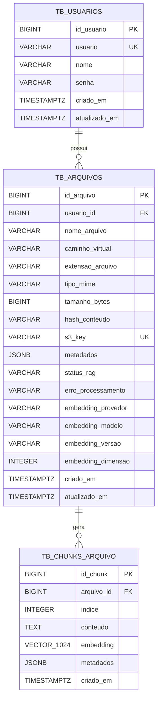

# Modelagem do banco de dados — MVP

Data da modelagem: 29/10/2026.

Status: implementado no `filemind-backend` pelas migrations Flyway V1 a V3 (PRs #3 e #4, mescladas em 02/11/2026) e validado no CI em PostgreSQL 16 com pgvector. Documento atualizado em 15/11/2026.

## 1. Objetivo

Definir o menor modelo de dados capaz de sustentar o escopo acordado para o FileMind:

- usuários proprietários de arquivos;
- arquivos Markdown armazenados no Amazon S3;
- metadados e estado do processamento no PostgreSQL;
- chunks e embeddings armazenados com pgvector;
- recuperação de contexto sempre restrita ao proprietário do arquivo.

Este documento evolui o protótipo de 14/10/2026. O arquivo `prototipo-mvp.sql` continua preservado como fotografia do backend existente naquela data.

## 2. Limites desta modelagem

Entram no modelo:

- usuários;
- arquivos;
- chunks e embeddings;
- caminho virtual;
- estados e erros do processamento RAG;
- metadados opcionais em JSONB.

Não entram neste momento:

- tabela de pastas;
- compartilhamento de arquivos;
- permissões por arquivo;
- histórico de chat;
- memória persistente de agentes;
- versionamento completo de documentos;
- auditoria detalhada.

## 3. Decisões de modelagem

### 3.1. Conteúdo e armazenamento

O conteúdo integral do arquivo fica no S3. O PostgreSQL mantém identificação, propriedade, organização, metadados e estado do processamento.

O conteúdo textual dos chunks fica no PostgreSQL porque ele participa diretamente da busca e da montagem do contexto enviado à IA.

### 3.2. Propriedade

Cada arquivo pertence a exatamente um usuário. O proprietário de um chunk é obtido pelo arquivo de origem; o `usuario_id` não será duplicado na tabela de chunks.

Toda consulta vetorial deverá unir chunks e arquivos e filtrar pelo usuário autenticado antes de enviar qualquer trecho ao modelo de linguagem.

### 3.3. Caminho virtual

`caminho_virtual` representa o caminho completo do arquivo dentro do FileMind, incluindo o nome, por exemplo:

```text
/documentacao/teste.md
```

O backend será responsável por normalizar o valor e manter seu último segmento coerente com `nome_arquivo`. A combinação de proprietário e caminho virtual será única.

Enquanto pastas não forem implementadas, todos os arquivos podem usar a raiz, por exemplo `/teste.md`. Não será criada uma tabela de pastas apenas para simular essa organização.

### 3.4. Metadados

Colunas relacionais são a fonte oficial para propriedade, chave S3, caminho virtual, tamanho, datas e estado do processamento.

O JSONB conterá apenas informações opcionais ou extensíveis, como título, autor, categoria, estatísticas e localização do chunk. Esses dados não concedem autorização.

### 3.5. Reprocessamento

`hash_conteudo` identifica o conteúdo atual do arquivo. A restrição única `(arquivo_id, indice)` impede dois chunks com a mesma posição para a versão corrente.

No MVP, uma reindexação deverá substituir os chunks do arquivo dentro de uma transação. Um histórico de versões poderá ser modelado futuramente, se necessário.

### 3.6. Dimensão e portabilidade do embedding

O MVP utilizará vetores de 1.024 posições. No desenvolvimento, o modelo padrão será BGE-M3 executado localmente pelo Ollama. A coluna será `vector(1024)` e a busca utilizará distância de cosseno.

O provedor, modelo e versão usados na indexação ficarão registrados no arquivo. Trocar o modelo exige reindexar seus chunks, mesmo quando a dimensão continuar igual.

Para o volume acadêmico do MVP, a busca exata é suficiente. HNSW ou IVFFlat só serão avaliados depois que o fluxo completo estiver validado e houver volume que justifique o índice aproximado.

## 4. Modelo conceitual



## 5. Modelo lógico e dicionário de dados

### 5.1. `tb_usuarios`

| Campo | Tipo lógico | Obrigatório | Regra |
| --- | --- | --- | --- |
| `id_usuario` | inteiro longo | sim | chave primária gerada pelo banco |
| `usuario` | texto curto | sim | identificador de login único |
| `nome` | texto | sim | nome apresentado pela aplicação |
| `senha` | texto | sim | armazena somente hash seguro, nunca senha em texto puro |
| `criado_em` | data e hora com fuso | sim | gerada pelo backend ou banco |
| `atualizado_em` | data e hora com fuso | sim | atualizada a cada alteração |

O nome da coluna `senha` foi mantido para reduzir divergência com a entidade Java atual. Seu conteúdo deverá ser um hash produzido por algoritmo próprio para senhas.

### 5.2. `tb_arquivos`

| Campo | Tipo lógico | Obrigatório | Regra |
| --- | --- | --- | --- |
| `id_arquivo` | inteiro longo | sim | chave primária |
| `usuario_id` | inteiro longo | sim | proprietário; chave estrangeira |
| `nome_arquivo` | texto | sim | nome apresentado ao usuário |
| `caminho_virtual` | texto | sim | caminho completo dentro do FileMind |
| `extensao_arquivo` | texto curto | sim | somente `MD` no MVP |
| `tipo_mime` | texto curto | não | tipo recebido e validado no upload |
| `tamanho_bytes` | inteiro longo | sim | valor maior ou igual a zero |
| `hash_conteudo` | texto de 64 caracteres | sim | SHA-256 do conteúdo atual |
| `s3_key` | texto | sim | identificador interno e único do objeto no S3 |
| `metadados` | JSONB | sim | dados opcionais; padrão `{}` |
| `status_rag` | texto curto | sim | `ENVIADO`, `PROCESSANDO`, `PROCESSADO` ou `ERRO` |
| `erro_processamento` | texto | não | resumo técnico controlado da última falha |
| `embedding_provedor` | texto curto | não | adaptador usado, por exemplo `ollama` |
| `embedding_modelo` | texto | não | identificador do modelo, por exemplo `bge-m3:567m` |
| `embedding_versao` | texto | não | versão imutável ou digest usado na indexação |
| `embedding_dimensao` | inteiro | não | `1024` no modelo atual |
| `criado_em` | data e hora com fuso | sim | criação no FileMind |
| `atualizado_em` | data e hora com fuso | sim | última alteração no FileMind |

Regras adicionais:

- `s3_key` não será exposta ao frontend;
- `(usuario_id, caminho_virtual)` será único;
- arquivos `PROCESSADO` deverão informar provedor, modelo, versão e dimensão;
- datas originais eventualmente recebidas ficarão em `metadados`, com nomes explícitos;
- o caminho local do computador do usuário não será persistido.

### 5.3. `tb_chunks_arquivo`

| Campo | Tipo lógico | Obrigatório | Regra |
| --- | --- | --- | --- |
| `id_chunk` | inteiro longo | sim | chave primária |
| `arquivo_id` | inteiro longo | sim | arquivo de origem; chave estrangeira |
| `indice` | inteiro | sim | posição do chunk no arquivo, iniciada em zero |
| `conteudo` | texto longo | sim | trecho utilizado na recuperação |
| `embedding` | vetor de 1.024 posições | sim | gerado pelo `EmbeddingProvider` configurado |
| `metadados` | JSONB | sim | seção, linhas e outros dados específicos do trecho |
| `criado_em` | data e hora com fuso | sim | momento de criação do chunk |

Regras adicionais:

- `(arquivo_id, indice)` será único;
- a exclusão do arquivo removerá seus chunks em cascata;
- o chunk não duplica proprietário, chave S3 nem metadados gerais do arquivo;
- o filtro por usuário será realizado pelo vínculo com `tb_arquivos`.

## 6. Fluxo de dados suportado

1. O backend identifica o usuário autenticado.
2. Valida que o upload possui conteúdo e extensão `.md`.
3. Calcula o SHA-256 do conteúdo.
4. Envia o arquivo ao S3.
5. Registra o arquivo com estado `ENVIADO`.
6. Altera o estado para `PROCESSANDO`.
7. Divide o Markdown em chunks e gera os embeddings pelo provedor configurado.
8. Substitui os chunks do arquivo em uma transação.
9. Marca o arquivo como `PROCESSADO` ou `ERRO`.
10. Na consulta, filtra os chunks pelo usuário e considera apenas arquivos `PROCESSADO`.

## 7. Integridade e exclusão

- A exclusão de um arquivo remove seus chunks por `ON DELETE CASCADE`.
- A exclusão de um usuário com arquivos fica bloqueada por `ON DELETE RESTRICT` até o grupo definir o fluxo completo de remoção.
- A remoção entre S3 e PostgreSQL precisa ser coordenada pelo serviço; uma transação de banco não desfaz automaticamente uma chamada ao S3.
- O conteúdo de `erro_processamento` não deverá conter credenciais, conteúdo integral do arquivo ou respostas sensíveis de provedores externos.

## 8. Situação no backend

Implementado e validado:

1. Flyway cria e altera o esquema; o Hibernate roda com `ddl-auto=validate` e apenas confere se as entidades batem com as tabelas;
2. `V1__criar_e_evoluir_estrutura_base.sql` cria ou evolui `tb_usuarios` e `tb_arquivos`, com caminho virtual, hash, datas, erro de processamento, dados do embedding, checagens e índices únicos;
3. `V2__adicionar_pgvector_e_chunks.sql` habilita o pgvector e cria `tb_chunks_arquivo` com `vector(1024)`;
4. `V3__alinhar_hash_conteudo_com_hibernate.sql` converte `hash_conteudo` para `VARCHAR(64)`;
5. upload restrito a Markdown, cálculo do SHA-256, caminho virtual na raiz e `s3_key` fora das respostas;
6. entidade `ChunkArquivo` e consulta por distância de cosseno filtrada por usuário, estado `PROCESSADO` e provedor, modelo e versão do embedding;
7. teste de integração no GitHub Actions contra PostgreSQL 16 com pgvector real;
8. senha gravada como hash BCrypt (PR #5 do backend, em revisão).

Ainda depende de outras frentes:

1. autenticação da API, usando o usuário autenticado no lugar do `idUsuario` enviado pelo cliente;
2. divisor de Markdown, `EmbeddingProvider`, indexação e endpoint de pergunta, conforme a [arquitetura do RAG](../rag/ARQUITETURA-RAG-MVP.md);
3. download, exclusão e substituição de arquivos.

## 9. Pontos ainda pendentes

A dimensão foi definida como `vector(1024)`. BGE-M3/Ollama será o padrão local, mas a arquitetura aceitará provedores alternativos por adaptadores. A ferramenta de migração foi definida: Flyway.

Ainda precisam de decisão do grupo:

1. estratégia de autenticação da API;
2. regra de substituição ou atualização do conteúdo do arquivo;
3. modelo de resposta local adequado à máquina de desenvolvimento;
4. provedor cloud de produção, somente depois de benchmark de qualidade, custo e privacidade;
5. diferenças com o protótipo do frontend: o login usa e-mail, e o banco guarda `usuario`; as pastas têm cor, e o banco guarda só `caminho_virtual`.

Só o item 5 pode exigir uma nova migration, caso o grupo decida guardar e-mail ou criar uma tabela de pastas.

## 10. Aplicação em um banco que já existe

O Flyway registra as versões executadas na tabela `flyway_schema_history`. Um banco vazio recebe V1 a V3 na primeira inicialização do backend, sem passo manual.

Num banco que já tem tabelas criadas pelo antigo `ddl-auto=update`, como o RDS do grupo:

1. fazer um snapshot do banco antes;
2. confirmar que o pgvector está disponível: `SELECT name, default_version FROM pg_available_extensions WHERE name = 'vector';`;
3. a V2 já executa `CREATE EXTENSION IF NOT EXISTS vector`; se o usuário da aplicação não tiver permissão para isso, o usuário master executa esse comando uma vez antes;
4. iniciar o backend uma única vez com `DB_FLYWAY_BASELINE_ON_MIGRATE=true`, para o Flyway aceitar o esquema existente como versão 0 e aplicar V1 a V3 sobre ele;
5. voltar a variável para `false` nas inicializações seguintes.

A V1 foi escrita para esse caso: preenche o caminho dos arquivos antigos com `/legado/<id>/<nome>` e cria as checagens como `NOT VALID`, para que linhas antigas, como arquivos de teste de outro formato, não bloqueiem a migração. As linhas novas passam por todas as checagens.

Usuários criados antes do hash continuam com a senha em texto puro e devem ser recriados ou removidos.

## 11. Artefatos de referência

As migrations em `filemind-backend/src/main/resources/db/migration` são a fonte oficial do esquema.

O arquivo [`modelo-fisico-mvp.sql`](modelo-fisico-mvp.sql) é a proposta de 29/10/2026 que originou as migrations e fica como referência de leitura. Ele não deve ser executado sobre um banco existente: `CREATE TABLE IF NOT EXISTS` não altera tabelas que já existem.
