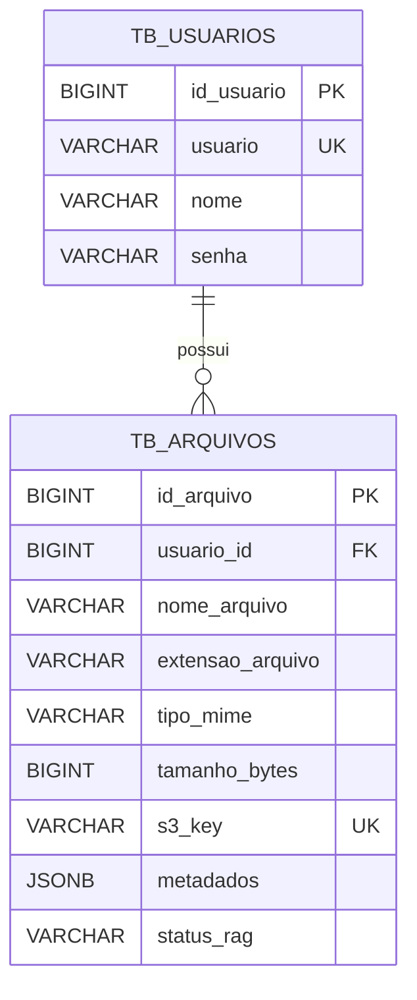

# Protótipo do banco de dados — MVP

Data da consolidação inicial: 14/10/2026.

## Objetivo

Documentar o menor modelo de banco que corresponde ao backend atualmente implementado e permite demonstrar a aplicação conectada ao PostgreSQL.

Este é um protótipo do MVP, não o modelo definitivo do FileMind.

## Evolução da modelagem

Em 29/10/2026 foi preparada uma modelagem-alvo alinhada ao escopo de Markdown, S3, PostgreSQL, pgvector e RAG:

- [`MODELAGEM-MVP.md`](MODELAGEM-MVP.md): modelo conceitual, lógico, regras e pendências técnicas;
- [`modelo-fisico-mvp.sql`](modelo-fisico-mvp.sql): DDL de referência para usuários, arquivos e chunks;
- [`prototipo-mvp.sql`](prototipo-mvp.sql): fotografia preservada das entidades implementadas em 14/10/2026.

O protótipo antigo não foi substituído porque ele documenta o estado observado do backend. A nova modelagem representa o destino pretendido e ainda precisa ser convertida em migrações versionadas antes de ser aplicada ao banco atual.

## O que já existe no backend

O código observado no `filemind-backend` possui:

- conexão PostgreSQL configurada por `DB_URL`, `DB_USER` e `DB_PASSWORD`;
- Spring Data JPA;
- criação e atualização automática das tabelas pelo Hibernate durante o desenvolvimento;
- entidade `Usuario` mapeada para `tb_usuarios`;
- entidade `Arquivo` mapeada para `tb_arquivos`;
- relação de muitos arquivos para um usuário;
- armazenamento do arquivo no Amazon S3 e persistência de seus dados no PostgreSQL.

## Modelo mínimo



Em termos simples: um usuário pode possuir vários arquivos, mas cada arquivo pertence a um único usuário.

## Tabelas

### `tb_usuarios`

| Coluna | Tipo sugerido | Regra |
|---|---|---|
| `id_usuario` | `BIGSERIAL` | chave primária |
| `usuario` | `VARCHAR(100)` | obrigatório e único |
| `nome` | `VARCHAR(255)` | obrigatório |
| `senha` | `VARCHAR(255)` | obrigatório; deve armazenar hash, nunca senha em texto puro |

### `tb_arquivos`

| Coluna | Tipo sugerido | Regra |
|---|---|---|
| `id_arquivo` | `BIGSERIAL` | chave primária |
| `usuario_id` | `BIGINT` | usuário proprietário; chave estrangeira obrigatória |
| `nome_arquivo` | `VARCHAR(255)` | nome apresentado ao usuário |
| `extensao_arquivo` | `VARCHAR(10)` | extensão aceita pelo backend |
| `tipo_mime` | `VARCHAR(100)` | tipo informado no upload |
| `tamanho_bytes` | `BIGINT` | tamanho não negativo |
| `s3_key` | `VARCHAR(1024)` | caminho interno do objeto no S3; deve ser único |
| `metadados` | `JSONB` | dados auxiliares do upload |
| `status_rag` | `VARCHAR(20)` | `ENVIADO`, `PROCESSANDO`, `PROCESSADO` ou `ERRO` |

O banco não armazena o conteúdo binário do arquivo. Ele armazena os dados do arquivo e a `s3_key`; o conteúdo permanece no S3.

## SQL de referência

O arquivo [`prototipo-mvp.sql`](prototipo-mvp.sql) descreve esse modelo de forma não destrutiva, usando `CREATE TABLE IF NOT EXISTS`.

Ele serve para revisão e demonstração. Atualmente o backend usa `spring.jpa.hibernate.ddl-auto=update`, portanto o SQL não deve ser executado automaticamente junto com o Hibernate sem antes o grupo escolher uma única estratégia de criação e migração do esquema.

Para uma evolução posterior, a recomendação é usar uma ferramenta de migração, como Flyway, e deixar de depender de `ddl-auto=update` fora do desenvolvimento.

## Demonstração mínima de hoje

Para comprovar a conexão com o banco, não é necessário demonstrar todo o RAG:

1. iniciar uma instância PostgreSQL local ou previamente autorizada;
2. criar um banco vazio chamado `filemind`;
3. definir `DB_URL`, `DB_USER` e `DB_PASSWORD` fora do Git;
4. iniciar o backend;
5. criar um usuário pelo endpoint `POST /usuarios`;
6. listar os usuários com `GET /usuarios`;
7. mostrar no PostgreSQL a linha criada em `tb_usuarios`;
8. explicar a relação planejada com `tb_arquivos`.

O upload para o S3 só deve ser demonstrado se as credenciais, o bucket e os custos já tiverem sido revisados pelo grupo. A comprovação da conexão PostgreSQL não depende de realizar uma nova operação na AWS.

## Consultas úteis para a apresentação

```sql
SELECT id_usuario, usuario, nome
FROM tb_usuarios
ORDER BY id_usuario;
```

```sql
SELECT
    a.id_arquivo,
    a.nome_arquivo,
    a.status_rag,
    u.usuario AS proprietario
FROM tb_arquivos AS a
JOIN tb_usuarios AS u ON u.id_usuario = a.usuario_id
ORDER BY a.id_arquivo;
```

As consultas não exibem senha nem credenciais.

## Fora deste protótipo

Não foram adicionadas tabelas para:

- chunks e embeddings;
- pastas;
- compartilhamentos;
- permissões avançadas;
- histórico de versões;
- auditoria;
- conversas com a IA.

Essas estruturas dependem de decisões que ainda não foram confirmadas. Adicioná-las agora aumentaria o escopo sem ajudar a demonstrar a conexão básica exigida.

## Pontos que precisam ser corrigidos antes de produção

- o backend atualmente atribui a senha recebida diretamente à entidade; deve ser aplicado hash seguro antes da persistência;
- o uso de `ddl-auto=update` deve ficar restrito ao desenvolvimento;
- `s3_key` deve ser tratada como identificador único;
- regras de exclusão de usuário com arquivos precisam ser decididas;
- arquivos e usuários precisam de autenticação e autorização reais;
- validações de tipo, tamanho e conteúdo do arquivo precisam ser endurecidas.

## Estado de validação

O modelo foi conferido contra as entidades Java observadas no `filemind-backend` no commit `33cc1c1`. O backend compilou com sucesso pelo Maven Wrapper em 14/10/2026. O SQL e a conexão da aplicação ainda não foram executados contra uma instância PostgreSQL nesta consolidação, pois o computador não possui PostgreSQL, `psql`, Docker ou variáveis `DB_*` configuradas.
